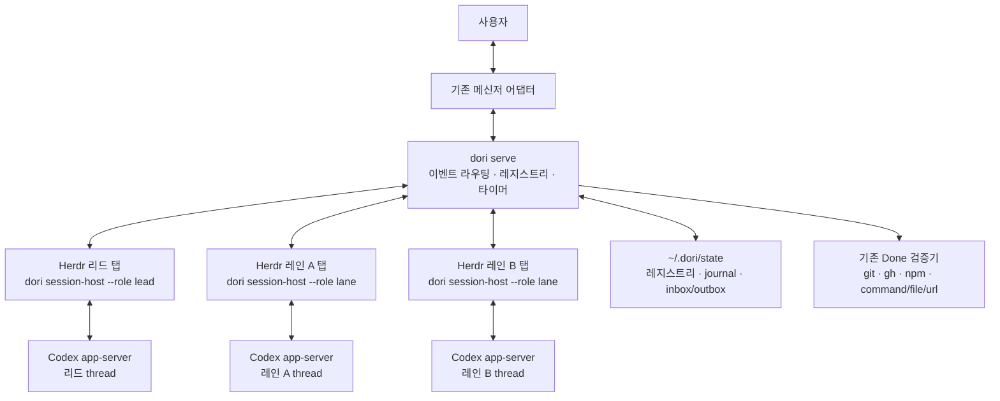
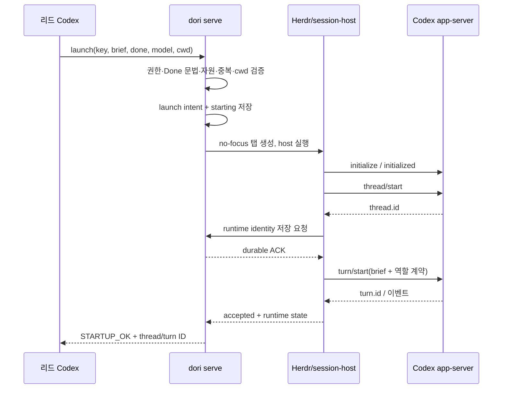

# Dori Codex Runtime 전환 기술 명세

- 상태: 구현 완료(working tree) — 운영 전환과 live 모델/메신저 검증은 별도
- 작성일: 2026-10-22
- 기준 저장소: `iyen`, commit `0057f49de9ae32f1bd0e38fe097d7430224bcb29`
- 로컬 확인 버전: `codex-cli 0.163.0`, Bun + TypeScript
- 목표: Dori의 메신저·리드·레인·완료 검증 구조를 유지하고, 리드와 모든 작업 레인의 에이전트 런타임을 Codex로 통일한다. OMO 실행·세션·goal·monitor 의존성을 제거한다.
- 범위: 이 문서는 구현 계약이다. 아래 신규 명령·파일·설정은 제안이며 아직 존재하지 않는다.

## Visible TUI 후속 구현 (2026-10-22)

기존 pane의 session-host 텍스트 출력 방식은 interactive Codex TUI 기준을 충족하지 못했다. 후속 구현에서는 Herdr `agent start/prompt/get/read/send-keys`가 실제 TUI의 session mutation을 소유한다. off-pane host는 전용 Unix WebSocket app-server endpoint를 감독하고 allowlist read-only observer로 정확한 userMessage operation marker와 실제 turn ID, goal 상태를 확인한다. observer는 thread start/resume, turn submit, goal mutation, approval response를 수행하지 않는다.

아래 초기 RPC 설계의 직접 mutation 부분은 이 후속 결정으로 대체한다. 설정·도구·플러그인·인증 갱신·기존 history는 established CODEX_HOME을 그대로 사용하며 Dori 역할, MCP capability, 모델/effort, 정책만 process-scoped override로 전달한다. 전역 설정을 수정하거나 auth snapshot을 덮어쓰지 않는다. 기존 private-RPC thread는 오래된 developer instructions를 그대로 재개할 수 있으므로 명시적 새 session/handoff migration을 지원하며 원래 history와 runtime identity를 보존한다.

운영 명령과 제한은 [runtime guide](../../skills/dori-mode/references/scripts.md#visible-runtime-and-recovery)를 따른다. live smoke 검증과 실제 운영 전환은 별도이며 이 변경 자체는 배포하지 않는다.

## 구현 기록 (2026-10-22)

이 문서의 설계를 코드로 옮겼다. 최종 검증: `bun test` **74 pass / 0 fail**, `bun run typecheck` 통과, `DORI_LIVE_PROTOCOL=1 bun test test/integration.test.ts` 통과. `git diff --check`, installer shell 문법, 문서 로컬 링크도 확인했다. 실행 중 확인한 차이는 다음과 같다.

- **에이전트 제어 도구는 stdio MCP**: macOS의 기본 `workspace-write`, network-off sandbox에서는 CLI의 Unix socket 연결이 차단되었다. sandbox를 완화하는 대신 `dori_runtime.control` MCP를 필수 서버로 주입한다. MCP가 레인별 capability로 기존 서비스 socket에 연결한다. 사용자 CLI와 host↔service IPC는 유지한다.
- 리드 레코드는 별도의 최상위 저장소 대신 `state/lanes/lead.json`에 둔다. 같은 revision/journal 경계를 사용하고 auto-close에서 제외한다.
- ingress는 명시적 JSONL ACK/replay 어댑터 계약을 제공한다. 실제 사용하는 agent-messenger 출력 형식을 추정하여 연결하지 않는다. 운영 어댑터 설정은 설치 절차다.
- 기존 native goal의 조회·pause/resume과 turn interrupt는 구현했다. 새 goal의 생성/예산 설정은 Codex의 기존 기능과 사용자의 지시를 따른다. 별도의 자동 continue 루프를 만들지 않았다.
- local-only protocol probe에서 실제 Codex 0.163.0의 initialize, 모델 목록, thread 생성, paused goal 조회, required MCP 연결과 tool 등록을 확인했다. 모델 추론과 실제 메신저 전송은 수행하지 않았다.
- 단위·프로세스 통합 테스트는 fixture runtime으로 중복 전달, lane 권한, pause, completion race, migration, 동일 thread 재개를 검증한다. active goal의 실제 자동 지속과 live connector 동작은 운영 전 smoke test 범위다.
- journal 자동 회전과 기본 Codex TUI 복제는 포함하지 않았다. 생성된 protocol 타입은 `runtime/generated/VERSION`에 버전을 기록했다.

실행 방법과 실제 명령 계약은 [README](../../README.ko.md), [runtime guide](../../skills/dori-mode/references/scripts.md)가 우선한다. 아래 항목은 초기 설계 근거와 인수 기준을 보존한다.

## 1. 결정 요약

**Dori는 업무를 배분하고 완료를 검증한다. Codex는 각 에이전트의 추론, 도구 실행, 대화 이력과 turn/goal을 담당한다. Herdr는 리드와 레인을 보여 주는 실행 공간으로 유지한다.**

1. 리드와 레인 모두 `codex app-server`를 사용하는 동일한 `session-host`로 실행한다.
2. Herdr의 작업별 탭, 기존 `dori` CLI, 메신저 스레드와 레인의 연결, JSON 레지스트리, 5분 완료 흐름을 유지한다.
3. 에이전트 제어는 app-server의 구조화된 RPC·이벤트로 바꾼다. 화면 문자열, Enter/Escape 입력, 프로세스 환경변수나 세션 파일명 추측을 제어 근거로 사용하지 않는다.
4. 항상 실행되는 `dori serve`가 inbound 이벤트, 레인 상태 변경, 타이머와 재연결을 소유한다. 리드의 한 turn이 끝나도 감시는 계속된다.
5. OMO와의 이중 런타임, provider 플러그인 계층, Responses API로 직접 만든 에이전트 루프는 만들지 않는다.
6. 모델 이름은 역할별 설정으로 분리하되 실행 경로는 모두 Codex다. 기존 `anthropic/...` 기본값과 fallback은 제거한다.

통합 표면으로 app-server를 고른 이유는 장기 세션의 입력, 중단, 승인, 이벤트를 Dori가 직접 다뤄야 하기 때문이다. 공식 문서도 사용자 정의 클라이언트에는 app-server, 프로그램에서 작업을 시작·재개하는 용도에는 SDK를 안내한다. [Codex App Server](https://learn.chatgpt.com/docs/app-server), [Codex SDK](https://learn.chatgpt.com/docs/codex-sdk)

### 유지할 시스템 계약

| 영역 | 유지할 행동 |
|---|---|
| 사용자 접점 | 하나의 봇, Telegram / Discord / Slack, 기존 말투·온보딩·메모리 정책 |
| 리드 | 짧은 질문은 직접 처리하고, 오래 걸리는 작업은 레인에 위임 |
| 레인 | 작업마다 독립 세션·Herdr 탭·brief·완료 조건·작업 디렉터리 |
| 라우팅 | 동일 작업의 후속 요청은 기존 메신저 스레드와 레인으로 연결 |
| 완료 | claim → 5분 이의 제기 → 실제 증거 확인 → 안전한 정리 |
| 중단 | 사용자가 기다리라고 하면 자동 지속·nudge를 모두 멈춤 |
| 자원 | memory/disk/pane 수에 따른 launch HOLD, heavy 작업 슬롯 |
| 추적 | 세션 재개, 상태 이력, 완료 receipt, `sync`의 비파괴적 drift 보고 |

메신저 공급자, 저장소 이름, 봇 이름은 런타임 전환과 별개다. upstream URL에 `omo`가 있다는 이유로 존재하지 않는 새 URL을 만들지 않는다.

## 2. 현재 구현과 교체 범위

현재 저장소는 별도의 상주 애플리케이션 서버 없이, 스킬을 읽는 리드 에이전트와 여러 CLI monitor 프로세스가 협력하는 구조다. `package.json`에 OMO npm 의존성이 있는 것은 아니다. 의존성은 실행 설정, 세션 탐색, 프롬프트와 제어 프로토콜에 분산되어 있다.

| 현재 근거 | 현재 동작 | 전환 |
|---|---|---|
| [`config.ts`](../../skills/dori-mode/scripts/src/config.ts) | `omo --model`, Claude 모델, `ulw set goal and work`, `~/.omo/agent/sessions` | 검증된 Codex binary·역할별 모델·실행 정책 |
| [`launch.ts`](../../skills/dori-mode/scripts/src/launch.ts) | pane에 실행 문자열 전달, 20초 후 화면/Herdr 상태 확인 | session-host handshake와 thread/turn 응답 확인 |
| `session-id.ts` (전환 시 삭제) | senpi/OMO 프로세스, `--session`, `PI_SESSION_ID`, 파일 시각 추측 | RPC가 반환한 `thread.id`를 즉시 저장 |
| [`panes.ts`](../../skills/dori-mode/scripts/src/panes.ts) | send-text → Enter → working 상태 변화 | 런타임 입력 RPC와 request/turn 식별자 |
| [`pause.ts`](../../skills/dori-mode/scripts/src/pause.ts) | `/goal pause`, `/goal resume`, 화면 정규식, Escape | goal RPC + turn interrupt + read-back |
| [`freshness.ts`](../../skills/dori-mode/scripts/src/freshness.ts) | 화면의 `[REPORT]`를 두 tick 동안 관찰 | 명시적 report 이벤트와 전송 ledger |
| [`sync.ts`](../../skills/dori-mode/scripts/src/sync.ts), [`dead-panes.ts`](../../skills/dori-mode/scripts/src/dead-panes.ts) | pane/process/screen 비교 | runtime heartbeat·thread 상태와 pane 존재 여부를 각각 비교 |
| [`registry.ts`](../../skills/dori-mode/scripts/src/registry.ts) | 프로세스마다 JSON read-modify-write | 단일 writer, lane별 직렬화, revision |
| [`done-flow.ts`](../../skills/dori-mode/scripts/src/done-flow.ts) | 완료 신호 검사, pane 알림, worktree 정리 | 검증기는 재사용, 알림·정지는 런타임 제어로 교체 |
| [`SKILL.md`](../../skills/dori-mode/SKILL.md), [`setup.md`](../../skills/dori-mode/references/setup.md) | 리드의 monitor 도구와 pi integration 가정 | serve + session-host 기반 운영 계약 |

`signals.ts`, `heavy-slot.ts`, 메신저 클라이언트와 thread ledger는 기존 구현을 활용한다. `routing.ts`의 재사용 판단은 pane idle 대신 런타임의 idle/approval/pause 상태를 확인하도록 바꾼다.

### 현재 동작과 요구사항을 구별할 부분

- `launchLane()` 내부에는 `canLaunch()` 호출이 없다. 현재는 리드가 지키는 절차다. 신규 launch 경계에서는 실제로 강제한다.
- JSON의 temp+rename은 부분 파일 읽기를 막지만 여러 writer의 갱신 손실을 막지 않는다. serve 도입 시 lane별 직렬화가 필요하다.
- 현재 직접 `close` 경로는 watcher의 `unpushedWork` 검사와 동일하지 않다. 신규 close는 진입점과 무관하게 동일한 검증을 통과해야 한다.
- 현재 worktree 검사는 untracked 파일을 제외한다. 신규 정리는 untracked 파일도 확인한다. 이는 데이터 보존 계약을 강화하는 의도적 변경이다.

위 항목은 소스 추적으로 확인한 설계 입력이며, 이번 문서 작업에서 장애를 재현하거나 코드를 수정한 것은 아니다.

## 3. 목표 아키텍처



### 프로세스와 책임

| 구성요소 | 책임 | 소유하지 않는 것 |
|---|---|---|
| `dori serve` | 입력 수신, durable queue, lane별 mutation 직렬화, monitor tick, launch/close workflow | LLM 추론이나 도구 실행 루프 |
| 리드 Codex | 요청 해석, 직접 처리/위임 판단, brief 작성, 사용자 답변, 결과 판단 | 타이머 생존과 저장소 동시성 |
| 레인 Codex | brief 실행, 코드·검증 작업, milestone/report/claim | 자신의 최종 완료 판정 |
| `session-host` | Codex subprocess 관리, JSON-RPC, 이벤트 전달, terminal 출력, 제어 요청 응답 | 업무 라우팅이나 완료 정책 |
| Herdr | 탭·pane 생성, 위치, 표시, 프로세스 실행 공간 | turn 수신·완료 여부 판정 |
| Codex | thread/turn 이력, 모델 호출, 도구·sandbox·승인·goal 동작 | 메신저 라우팅, Dori 완료 증거의 진실성 |

v1은 세션당 app-server 프로세스 하나와 thread 하나를 사용한다. 프로세스 하나에 모든 레인을 넣는 방식보다 비용은 크지만, 현재 레인별 실행 격리와 장애 범위를 유지한다. 메모리 비용은 실제 동시 레인 smoke test로 측정한다.

serve ↔ session-host는 사용자 전용 로컬 Unix socket으로 연결한다. app-server는 session-host의 stdio 자식이다. 공개 TCP 포트, 웹 대시보드, 새 분산 큐는 추가하지 않는다. CLI는 socket client이며 daemon이 없으면 명확히 실패한다. 몰래 두 번째 writer나 스케줄러를 띄우지 않는다.

비교한 대안은 `agentCommand`만 Codex TUI로 바꾸는 방법과 SDK로 turn을 호출하는 방법이다. 전자는 화면·입력·monitor 의존성이 남고, 후자는 본 설계가 필요한 제어 기능을 별도 검증해야 한다. app-server 직접 연동을 선택하되 transport와 타입 변환에만 얇은 경계를 둔다. 메신저·완료 정책을 새 프레임워크로 재작성하지 않는다.

Herdr 탭에는 Codex 이벤트를 사람이 읽을 수 있게 출력한다. 기본 Codex TUI의 완전한 복제는 범위 밖이다. 사용자는 `dori input`, `pause`, `resume`, 승인 명령으로 해당 세션을 조작한다. 같은 thread를 TUI와 session-host에서 동시에 제어하지 않는다.

## 4. Codex 연동 계약

### 4.1 버전과 근거

로컬 `codex-cli 0.163.0`에서 다음을 실행해 타입을 확인했다. 모델 호출이나 계정 인증은 수행하지 않았다.

```sh
codex --version
codex app-server --help
codex app-server generate-ts --out <temporary-directory>
```

이하 RPC 명칭과 필드는 이 바이너리가 생성한 `ClientRequest.ts`, `ServerRequest.ts`, `ServerNotification.ts`, `v2/*.ts`를 근거로 한다. 공개 문서만으로 지원 버전을 추정하지 않는다. 구현 시 선택한 Codex 버전을 고정하고 생성 타입을 `runtime/generated/`에 둔다. `0.163.0`은 조사 기준이지 아직 검증된 운영 버전은 아니다.

공식 app-server 문서는 thread·turn·goal RPC와 버전별 스키마 생성을 설명한다. [프로토콜 문서](https://learn.chatgpt.com/docs/app-server)

### 4.2 초기화와 thread 식별

1. session-host가 검증된 binary를 argv로 실행한다: `codex app-server --listen stdio://`.
2. stdout은 JSON-RPC 스트림으로만 읽고 stderr는 별도 진단 로그로 받는다. 분할 JSON 라인, 순서가 섞인 응답·notification·서버 요청을 처리한다.
3. `initialize` → 성공 응답 → `initialized` 순서를 지킨다.
4. 새 작업은 `thread/start`, 재개는 저장된 ID로 `thread/resume`을 호출한다.
5. 반환된 **`thread.id`**를 `runtime.threadId`에 저장하고 serve의 durable ACK를 받은 뒤 첫 turn을 시작한다.
6. `Thread`에는 별도의 `sessionId`도 존재한다. 둘을 같은 것으로 가정하지 않는다. RPC 주소에는 `thread.id`를 사용한다.

`thread/start`에는 `cwd`, 선택된 `model`, 명시적 sandbox/approval 정책과 역할 지침을 전달한다. `baseInstructions`를 통째로 대체하기보다 `developerInstructions`와 명시적 skill 입력으로 Dori 계약을 주입한다. 저장소 AGENTS.md와 선택된 스킬의 적용 여부는 통합 테스트에서 확인한다.

### 4.3 최소 RPC 매핑

| Dori 기능 | Codex 계약 | Dori 판정 |
|---|---|---|
| 새 세션 | `thread/start` | 반환 ID를 저장해야 생성 완료 |
| 기존 세션 | `thread/resume { threadId }` | 명시된 thread 복원; 새 ID로 조용히 대체하지 않음 |
| 입력 | `turn/start { threadId, input }` | 반환 turn ID와 입력 correlation 저장 |
| 작업 중 수정 지시 | `turn/steer { threadId, expectedTurnId, input }` | turn mismatch는 다시 조회 후 판단 |
| 중단 | `turn/interrupt { threadId, turnId }` | ACK만으로 중단 완료라고 하지 않음 |
| 상태 확인 | `thread/read`, `thread/turns/list`, `thread/items/list` | 페이지 끝까지 필요한 항목 조회 |
| goal 관리 | `thread/goal/get`, `thread/goal/set` | 응답과 read-back으로 상태 확인 |
| 모델 검증 | `model/list` | 선택 모델·effort 지원 여부 확인 |

입력 예시의 형식은 다음과 같다. Dori 내부 `operationId`는 별도로 유지한다.

```json
{
  "method": "turn/steer",
  "id": 42,
  "params": {
    "threadId": "<stored-thread-id>",
    "expectedTurnId": "<observed-active-turn-id>",
    "clientUserMessageId": "<message-correlation-id>",
    "input": [{ "type": "text", "text": "추가 요구사항", "text_elements": [] }]
  }
}
```

`clientUserMessageId`를 서버의 exactly-once 보장으로 해석하지 않는다. 응답을 잃었으면 history와 operation journal을 대조한다. 실행 여부를 확정할 수 없는 작업은 `unknown`으로 두고 자동 재전송하지 않는다.

### 4.4 이벤트와 완료의 구별

- `turn/started`, `turn/completed`, `thread/status/changed`로 런타임 상태를 갱신한다.
- `item/agentMessage/delta`는 표시용이다. 완성된 agent message item과 명시적 report를 저장·공유 기준으로 삼는다.
- turn의 `completed`, `failed`, `interrupted`는 레인의 `closed`와 다르다.
- Codex goal의 `complete`도 Dori의 `verified-done`과 다르다. 완료 신호는 Dori가 다시 확인한다.
- thread의 `activeFlags`에 승인·사용자 입력 대기가 있으면 nudge로 깨우지 않는다.
- 알 수 없는 notification은 진단 로그에 남길 수 있지만, 알 수 없는 서버 요청은 자동 승인하지 않는다.

### 4.5 Goal 정책

작업 레인은 승인된 지속 작업 범위에서 Codex native goal을 사용할 수 있다. 리드에는 무한한 포괄 goal을 설정하지 않고 inbox 이벤트로 turn을 시작한다. Codex goal은 여러 turn의 지속 작업을 위한 기능이다. [Using Goals in Codex](https://developers.openai.com/cookbook/examples/codex/using_goals_in_codex)

- goal 생성 권한과 작업 범위를 launch 요청에 기록한다. 단순 질문을 자동으로 지속 goal로 바꾸지 않는다.
- goal 상태: `active / paused / blocked / usageLimited / budgetLimited / complete`.
- `thread/goal/set`의 `origin`은 실제 출처대로 `user` 또는 `automatic`으로 기록한다. 자동 monitor 동작을 사용자 요청으로 위장하지 않는다.
- token budget은 명시된 경우에만 설정한다. 한도에 걸린 goal을 자동으로 해제하거나 무제한 goal로 교체하지 않는다.
- 목표를 바꾸는 요청과 상태만 바꾸는 요청을 분리한다. pause/resume 때 objective를 재설정해 사용량을 초기화하지 않는다.
- Dori 자체의 반복 `continue` 루프는 두지 않는다. native goal과 별도의 자동 재시작 루프가 서로 작업을 증폭시키지 않게 한다.

`automatic` origin으로 완료 대기 중 goal을 멈추고 이의 제기 후 재개하는 동작은 타입 존재만으로 보장되지 않는다. Phase 0에서 실제 정책·race를 검증한다. 불가능하면 지원되는 비활성화 절차를 확정하기 전까지 native goal을 포함한 출시를 막는다. OMO로 fallback하지 않는다.

## 5. 상태와 저장 계약

### 5.1 Lane schema v2

기존 업무 상태는 유지하고 실행 상태를 분리한다. `starting`이나 `waiting_approval`을 `done-claimed`와 같은 enum에 섞지 않는다.

```ts
type LaneStatus =
  | "working" | "paused" | "done-claimed"
  | "verified-done" | "not-done" | "closed";

type RuntimeState =
  | "starting" | "idle" | "running"
  | "waiting_approval" | "waiting_input"
  | "pausing" | "recovering" | "failed" | "stopped";

type RuntimeRef = {
  kind: "codex";
  threadId?: string;       // thread/start의 durable ACK 전에는 없음
  activeTurnId?: string;
  state: RuntimeState;
  hostInstanceId: string;
  generation: number;     // 재시작 전 host의 늦은 이벤트 차단
  binaryVersion: string;
  model?: string;
  effort?: string;
  lastHeartbeatAt?: string;
};

type LaneV2 = {
  schemaVersion: 2;
  revision: number;
  key: string;
  thread: string;         // 기존 메신저 reference; Codex thread와 다름
  status: LaneStatus;
  runtime: RuntimeRef;
  dispatchBlocked: boolean;
  holdReason?: "owner-pause" | "done-review" | "recovery";
  pausedFrom?: LaneStatus;
  cycle: number;          // 닫힌 작업 재개 시 새 완료 주기
  // title, brief, done, pane/tab, cwd, worktrees, claim/history/receipt 유지
};
```

리드는 `state/lead.json`에 동일한 RuntimeRef를 갖는다. 리드는 lane의 5분 auto-close 대상이 아니다. 메신저 thread → lane key 매핑은 Codex 재시작과 무관하게 유지한다.

### 5.2 단일 writer와 복구

- `dori serve`만 lane·lead·queue 상태를 쓴다. CLI, session-host, monitor는 mutation을 요청한다.
- 프로세스 단일화에 더해 **lane별 async queue**로 read-check-write와 외부 부작용 시작 순서를 직렬화한다.
- mutation은 `operationId`, 예상 revision, 상태 변화를 journal에 기록한 뒤 snapshot을 atomic rename으로 갱신하고 ACK한다.
- JSONL journal의 마지막 불완전 record는 복구 시 분리한다. snapshot의 적용 revision 이후만 재생한다. 내구성 보장에는 flush/fsync를 포함한다.
- 하나의 외부 호출은 intent → 실행 → 결과/불명 상태로 기록한다. 프로세스가 중간에 죽어도 성공했다고 추측하지 않는다.
- 긴 검증·네트워크 호출 동안 lane mutation queue를 점유하지 않는다. operation token을 저장하고 호출을 시작한 뒤, 결과를 새 mutation으로 반영한다. 그 사이 들어온 pause/objection은 즉시 기록하고 오래된 결과의 commit을 막는다.
- host의 `generation`과 연결 소유권을 확인하고 오래된 이벤트를 거절한다. 같은 thread의 활성 session-host는 하나다.
- daemon instance lock은 PID만 믿지 않고 instance identity와 heartbeat를 확인한다.

v1은 기존 JSON snapshot과 작은 append-only journal을 사용한다. SQLite/Redis 도입은 전환의 선행 조건이 아니다. 회전·보존 정책은 terminal transcript와 event journal을 분리하고, 복구에 필요한 미완료 operation은 지우지 않는다.

## 6. 실행 흐름

### 6.1 리드와 inbound

1. `dori serve`가 상태와 미완료 operation을 복구하고 monitor들을 시작한다.
2. Herdr 리드 탭에서 session-host를 시작하고 기존 lead thread를 재개하거나 새로 만든다.
3. 기존 messenger watch 출력과 Slack polling을 `InboundEvent`로 정규화한다. platform/account/conversation/message ID를 dedupe key로 삼는다.
4. 소유자 identity를 확인하고 durable inbox에 저장한 뒤 ACK한다. 플랫폼 cursor는 inbox 저장 전에 전진시키지 않는다.
5. 리드 idle이면 새 turn, 작업 중이면 steer 또는 durable queue로 전달한다. 승인 대기 중에는 입력을 승인 답변으로 오인하지 않는다.
6. 리드는 직접 처리하거나 기존 `dori launch` 명령으로 레인을 요청한다. 모든 AI 판단은 Codex에서 일어난다.

메신저별 watch 프로세스도 serve가 감독한다. Telegram/Discord 수신은 현재 운영의 agent-messenger 연결을 유지하며, 정확한 watch output/cursor 형식은 Phase 0에서 고정한다. stdin 이벤트 하나를 받았다고 바로 에이전트 작업 성공으로 표시하지 않는다.

inbox는 대상별 순서를 유지하고 pause·approval 응답·objection 같은 제어 이벤트를 일반 작업보다 먼저 처리한다. 새 메시지로 이미 수락한 작업이 사라지지 않게 한다. source 이벤트는 사용자 직접 요청, 인용/전달 내용, 자동 알림을 구분하고 자동 알림이 사용자 권한을 갖지 않게 한다. 플랫폼당 message ID가 없는 경우 안정적인 cursor/sequence를 확보하기 전 운영 수신을 활성화하지 않는다.

기존 1분 내 응답 계약은 LLM이 막힌 경우에도 수신 ACK/대기 사유를 보낼 수 있게 한다. 15분 진행 보고 정책과 현재 20분 fallback 설정의 차이는 유지하되, 신규 정책을 바꿀 때는 별도 설정 변경으로 기록한다.

### 6.2 Launch



- brief 원본을 반복 수정하지 않는다. 작업별 생성 brief에 footer를 한 번 합성하고 hash를 기록한다.
- 병렬 writer 레인은 기록된 base SHA에서 별도 worktree를 준비하고 소유 파일 범위를 brief에 넣는다. 사용자 작업 디렉터리를 임의 삭제·초기화하지 않는다.
- `canLaunch` HOLD면 queue에 남기고 탭을 만들지 않는다. CPU 부하만으로 launch를 막지 않는 현재 정책과 heavy 작업 제한을 구별한다.
- STARTUP_OK는 host 연결, thread 저장, 첫 입력의 RPC 수락을 뜻한다. 업무 성공을 뜻하지 않는다.
- timeout/접속 단절은 STARTUP_UNCONFIRMED로 남긴다. 생성한 탭·thread를 먼저 reconcile한 뒤 재시도한다.
- 같은 `operationId`의 launch는 동일 결과를 반환한다. 기존 lane key를 덮어쓰지 않는다.

### 6.3 Pause / resume

pause는 두 단계로 처리한다.

1. 사용자의 pause intent를 먼저 저장하고 `dispatchBlocked=true`로 만든다. 즉시 freshness, 새 입력 dispatch, queued continuation을 차단한다.
2. goal이 있으면 `thread/goal/set`으로 pause하고 `get`으로 확인한다. 진행 중 turn은 `turn/interrupt`로 중단하고 terminal event 또는 history read-back으로 정지를 확인한다.

goal 비활성 + 활성 turn 없음이 확인되면 업무 상태를 `paused`로 확정한다. RPC가 불확실하면 `runtime.state=pausing`, dispatch 차단을 유지하고 `PAUSE_UNVERIFIED`/exit 3을 반환한다. 실패했다고 nudge를 다시 허용하지 않는다. 이는 현재 실패 경로를 의도적으로 강화한다.

resume은 명시적 재개 요청이 있을 때만 동작한다. pending pause/recovery가 없는지 확인하고, 원래 goal과 `pausedFrom`을 복원한다. goal이 없던 세션에는 새 goal을 만들지 않는다. goal 활성화가 자체 continuation을 시작했다면 별도 `turn/start`를 중복 호출하지 않는다. 대기 사용자 입력은 이후 같은 lane queue에서 처리한다.

interrupt로 이미 일어난 외부 부작용이 취소되었다고 표현하지 않는다. 별도 detached process의 정지는 추적된 소유 프로세스에 한정하고, 확인되지 않은 자식 작업은 남은 작업으로 보고한다.

### 6.4 진행 보고와 freshness

신규 `dori report <key> --kind milestone|blocker|question|done --text-file PATH --event-id ID`가 명시적 report 이벤트를 만든다. 레인 host identity와 key를 검증한다. 기존 `[REPORT]` 문자열은 사람이 읽는 출력으로만 유지한다.

- report 이벤트 ID로 중복을 제거한다. `lastSeenReport`처럼 화면 두 번 읽기에 기대지 않는다.
- 경과 시간은 모델 토큰 출력이 아니라 마지막 사용자 전달/보고 시간을 기준으로 한다.
- 작업 중 nudge는 turn을 새로 띄우지 않고 steer한다. 승인/입력/owner-pause/done-review/recovery 상태에서는 nudge하지 않는다.
- 진행 보고 hook 실패를 POSTED로 기록하지 않는다. 성공 receipt 또는 전송 불명 상태를 남긴다.
- outbox는 외부 서비스의 exactly-once 전송을 가정하지 않는다. timeout 후 조회 가능한 message ID/nonce로 확인하고, 불명확하면 중복 자동 전송을 막는다.

### 6.5 완료와 정리

업무 상태 흐름은 다음을 유지한다.

```text
working / not-done -> done-claimed -> verified-done -> closed
                          |
                          +-- objection / failed evidence -> not-done
working / not-done <-> paused
closed -> 새 cycle의 working (기존 thread 재개)
```

1. claim을 journal에 기록하고 `claim.at + closeAfterMin`을 deadline으로 저장한다. 같은 claim ID의 재전송은 deadline을 연장하지 않는다.
2. `holdReason=done-review`로 새 dispatch를 막고 goal의 자동 지속을 정지시킨다. claim을 실행한 shell tool에는 durable 접수 ACK를 먼저 반환한다. tool 응답을 기다리는 turn을 동기 interrupt하면서 교착시키지 않는다.
3. 현재 turn이 정리되고 런타임이 quiescent한지 확인한다. 정지가 불명확하면 deadline이 지나도 닫지 않는다.
4. 이의가 오면 이유와 claim cycle을 기록한다. goal·dispatch를 복원하고 같은 Codex thread에 수정 요청을 전달한다.
5. deadline 이후 모든 Done 신호, worktree, 미전송 변경과 활성 작업을 다시 확인한다. restart 후에도 원래 deadline을 유지한다.
6. verify 중 도착한 이의 제기를 놓치지 않도록 긴 검사 뒤 revision·claim ID·objection queue를 다시 확인한다. irreversible cleanup 시작 전 마지막 close fence를 둔다.
7. 검증 성공 후 runtime 정지 → 완료 알림 outbox 기록 → 소유 worktree 정리 → Herdr 탭 종료 순으로 진행하고 각 결과를 receipt에 남긴다.
8. runtime/worktree/tab 정리가 끝나지 않으면 `verified-done`과 cleanup 단계에 머물고 재확인한다. 외부 메시지 전송 실패는 outbox에 남길 수 있지만 성공했다고 표시하지 않는다.

`dori close` 직접 호출도 5번 이후의 동일한 검사·fence를 사용한다. 업무 증거가 없는 강제 close는 제공하지 않는다.

worktree 삭제는 소유권이 기록된 경로만, untracked/dirty/unpushed 확인 후 `git worktree remove`로 한다. `--force`는 사용하지 않는다. Codex thread 기록은 지우지 않는다. close 후 재개를 위해 thread ID·brief·receipt·원래 repository 경로를 보존한다.

### 6.6 재시작, sync, 닫힌 작업 재개

- pane은 살아 있지만 app-server가 죽었으면 runtime failure다. pane이 없더라도 thread 기록은 남아 있을 수 있다.
- session-host heartbeat를 5초마다 보내고 20초 누락 시 recovering으로 취급하는 것을 초기 기본값으로 한다. 즉시 새 세션을 띄우지 않고 소유 프로세스 생존을 확인한다.
- host 제어 채널을 잃으면 자체 watchdog이 자동 goal 지속을 멈추고 active turn 정지를 시도한다. 확인 실패는 재연결 후 보고한다.
- daemon은 살아 있는 host와 다시 연결한다. 이전 host의 정지가 확인되기 전 동일 thread의 새 writer를 만들지 않는다.
- 명확히 실패한 연결·읽기 요청만 bounded exponential backoff로 재시도한다. 초기 정책은 1/2/4/8/16초, 5회 실패 후 운영 경고이며 재연결 성공 시 초기화한다. 외부 mutation과 결과 불명의 입력 전송에는 이 정책을 그대로 적용하지 않는다. rate limit은 제공된 retry-after를 존중하고 모델을 자동 변경하지 않는다.
- `thread/read`와 history를 대조한 후 필요한 경우 `thread/resume`한다. read에서 `notLoaded`가 나왔다고 thread 유실로 판단하지 않는다.
- 닫힌 작업의 후속 요청은 동일 메신저 thread, 동일 lane key, `cycle+1`로 연다. 기존 claim/deadline은 종료된 cycle에 보존하고 새 cycle에 적용하지 않는다.
- 삭제된 worktree cwd는 repository/branch 정보를 이용해 새로 준비한다. 존재하지 않는 경로로 resume하지 않는다.
- Codex thread가 실제로 없으면 자동으로 빈 대화를 이어 붙이지 않는다. 상태를 명시하고 보존 brief/receipt를 사용하는 새 thread 인계를 기록한다.
- 기존 외부 Codex TUI 채택은 `adopt --thread-id`와 단독 소유권 인계 후에만 허용한다. OMO 세션 live adopt와 argv/env 추측은 제거한다.
- `sync`는 기본 read-only다. `--write`도 검증된 mapping/heartbeat만 갱신하고 충돌하는 thread ID를 임의 교체하지 않는다.

## 7. 승인, 인증과 도구

Codex server request를 메신저/terminal의 해당 작업에 연결한다. command/file/permissions 승인, 사용자 질문, MCP elicitation은 서로 다른 요청으로 취급한다.

- pending request key는 host generation + RPC ID + thread/turn ID다. owner identity와 작업 스레드를 함께 검증한다.
- 응답은 생성된 타입에 맞는 payload로 돌려준다. 뒤늦은 응답이나 중복 클릭으로 다음 요청을 승인하지 않는다.
- 오래된 host의 request ID를 새 프로세스로 replay하지 않는다. 재생성된 요청에는 새 approval ID가 필요하다.
- configured policy가 이미 허용한 작업은 추가 승인하지 않는다. 지원되지 않는 승인을 자동 허용으로 대체하지 않는다.
- 세션마다 필요한 skills/MCP/CLI를 doctor에서 확인한다. OMO의 내장 도구가 Codex에 자동 존재한다고 가정하지 않는다. `memory`, monitor, messenger 연결은 setup 항목으로 명시한다.
- 기본 모델은 Codex 설정을 상속할 수 있으나 resolved 모델·provider·effort를 기록한다. OMO/Anthropic 실행 경로나 custom provider 우회가 발견되면 시작을 거절한다. 모델 선택 실패 시 다른 모델로 조용히 fallback하지 않는다.
- 기존 Codex 로그인 상태를 사용한다. API key가 필요한 설치는 consuming process에만 주입한다. 이 Mac에서는 `~/.local/bin/op-agent`와 명시적 vault를 사용하며 secret 값을 config/journal/argv에 기록하지 않는다.
- runtime 프로세스 환경을 역할별 allowlist로 구성한다. messenger credential은 messenger 프로세스에만 전달하고 작업 레인에 상속하지 않는다.
- socket/state 권한은 사용자 전용으로 두고, lane-scoped 제어 권한을 사용한다. 이것은 같은 OS 사용자로 실행되는 악성 코드에 대한 완전한 격리가 아님을 전제로 한다. 파일·네트워크 경계는 Codex sandbox가 담당한다.

리드만 launch/adopt/reopen과 다른 레인 제어를 요청할 수 있다. 작업 레인은 자신의 report/claim/status만 요청한다. 소유자의 pause/resume/승인 권한은 messenger ingress가 인증한 operation에 붙이고 레인이 텍스트로 주장할 수 없게 한다. Codex 내부의 추가 에이전트 spawn이 이 레지스트리를 우회하지 않도록 사용 가능한 도구·기능 설정으로 제한한다. 그 제한을 강제할 수 없다면 descendant 등록·정지 추적을 추가하기 전 다중 에이전트 기능을 출시 범위에서 제외한다.

## 8. CLI와 설정 변경

### 8.1 기존 명령

`launch`, `claim-done`, `object-done`, `close`, `pause`, `resume`, `sync`, `can-launch`, `heavy`, `send`, `presence`, `transcribe`의 사용자 목적은 유지한다.

- `launch --model`은 Codex 모델을 가리킨다.
- `adopt`는 `--thread-id`를 필수로 받는다. pane만으로 세션을 추측하지 않는다.
- `watch`, `freshness`, `dead-panes`, `guard`, `inbound`는 serve가 소유한 작업을 조회·구독하거나 단발 tick을 요청한다. 여러 CLI가 별도 스케줄러를 띄우지 않는다.
- `dead-panes` 이름은 호환 alias로 남기되 runtime failure와 pane loss를 구분해 출력한다.
- 기존 exit code 0=성공, 2=업무 상태상 거절, 3=불확실, 4=launch HOLD를 유지하고 신규 오류를 문서화한다.

### 8.2 신규 명령

```text
dori serve
dori doctor
dori session-host --role lead|lane [--key KEY]
dori input <key|lead> --text-file PATH
dori report <key> --kind KIND --text-file PATH --event-id ID
dori approval list
dori approval respond <id> --response-file PATH
dori reopen <key> --text-file PATH
dori migrate --dry-run
dori migrate --apply
```

`session-host`는 내부 실행 명령이다. 실제 메신저 문장은 argv/file/JSON으로 전달하고 shell에 삽입하지 않는다. Herdr `pane run`의 shell 문자열이 필요한 구간은 고정된 executable과 안전하게 quote한 경로·식별자만 사용한다.

### 8.3 제안 config v2

```json
{
  "schemaVersion": 2,
  "defaultCwd": "~/projects/iyen",
  "laneWorkspace": "",
  "runtime": {
    "kind": "codex",
    "binary": "codex",
    "requiredVersion": "0.163.0",
    "transport": "stdio",
    "startupTimeoutMs": 30000,
    "rpcTimeoutMs": 15000,
    "heartbeatIntervalMs": 5000,
    "heartbeatTimeoutMs": 20000,
    "roles": {
      "lead": { "model": null, "effort": null },
      "lane": { "model": null, "effort": null }
    },
    "sandbox": "workspace-write",
    "approvalPolicy": "on-request"
  },
  "nudgeAfterMin": 15,
  "postAfterMin": 20,
  "closeAfterMin": 5,
  "heavySlots": 1,
  "hooks": {}
}
```

`null` model/effort는 검증된 Codex 설정 상속이다. requiredVersion은 Phase 0 후 지원 버전으로 확정한다. sandbox/approval 예시는 제품 기본값 제안이며, 현재 이 명세 작성 세션의 권한을 바꾸는 설정이 아니다. 사용자·조직이 지정한 실행 정책을 설치 과정에서 조용히 완화하지 않는다.

기존 `agentCommand`, `launchKeywords`, `sessionsDir`, `deadPanePatterns`, provider 형식 `defaultModel`은 제거한다. `leadPane`은 배포 위치의 호환 정보로 유지할 수 있지만 리드 라우팅 식별자는 `lead.json`이다. guard/heavy/hooks, `DORI_CONFIG`, `DORI_STATE_DIR`은 유지한다.

## 9. 파일별 구현 계획

아래 경로는 `skills/dori-mode/scripts/` 기준이다. 초기 구현은 하나의 Bun 패키지 안에서 진행한다.

| 파일 | 변경 내용 |
|---|---|
| `src/runtime/protocol.ts`, `generated/` | 버전 고정 RPC 타입, framing, pending request, timeout, server request |
| `src/runtime/codex.ts` | start/resume/input/steer/interrupt/goal/status 기능 |
| `src/runtime/session-host.ts` | subprocess·heartbeat·재연결·terminal 출력 |
| `src/service.ts`, `src/ipc.ts` | 단일 daemon, 로컬 control socket, 역할별 command dispatch |
| `src/journal.ts`, `src/registry.ts` | version/revision, operation 기록, lane queue, recovery |
| `src/inbox.ts`, `src/outbox.ts` | inbound dedupe, routing, 외부 전송 receipt |
| `src/config.ts`, `src/cli.ts` | config v2, doctor, 신규 명령과 기존 명령 client화 |
| `src/launch.ts`, `src/routing.ts` | 자원 검사, worktree 소유권, startup handshake |
| `src/pause.ts`, `src/done-flow.ts` | 구조화된 goal/turn 제어와 close fence |
| `src/freshness.ts`, `src/dead-panes.ts`, `src/sync.ts` | 이벤트/heartbeat 기반 감시 |
| `src/panes.ts` | Herdr 위치·생성·종료만 담당; sendVerified 제거 |
| `src/session-id.ts` | 삭제. 세션 파일 파싱 대체 구현도 만들지 않음 |
| `test/fakes.ts`와 신규 protocol fixtures | fake Codex transport, fake host, deterministic clock |
| `install.sh` | Codex 호환성 검사와 serve/lead 실행 안내; 기존 config 덮어쓰기 금지 |
| 스킬, references, 4개 README | Codex-only 설치·운영·세션·복구·마이그레이션 문서 |

별도 provider interface와 factory는 두지 않는다. 테스트에 필요한 작은 runtime/transport 계약만 주입한다. Dori 도메인 모듈이 Codex wire type을 직접 import하지 않도록 `runtime/codex.ts`가 변환한다.

## 10. 마이그레이션과 롤백

### 기존 데이터 처리

1. `migrate --dry-run`은 legacy config·lane 목록·오래된 active 상태·누락 brief/worktree를 보고한다. 세션이나 외부 자원을 변경하지 않는다.
2. apply 전 legacy 리드/monitor를 중지하고 실행 중 OMO 레인의 작업을 정지·확인한다. OMO와 Codex가 같은 checkout을 동시에 수정하지 않게 한다.
3. config/state를 시간·해시가 붙은 백업으로 보존한다. migration journal로 중간 실패와 재실행을 처리한다.
4. 메신저 reference, lane key, brief, Done 조건, history, receipt, worktree 소유권을 보존한다.
5. OMO session ID는 `legacy.sessionId` 같은 이력 정보로만 보관한다. `runtime.threadId`로 복사하지 않는다.
6. 진행 작업은 목표·현재 변경·검증 결과·남은 일·사용자 대기 요청·관련 링크를 인계 문서로 만든 뒤 새 Codex thread를 시작한다. transcript의 바이너리/내부 포맷 변환은 하지 않는다.
7. 기존 `paused` 레인은 dispatch 차단 상태로 옮긴다. `done-claimed`는 기존 시각을 보존하되 runtime·증거 확인이 끝날 때까지 auto-close를 보류한다. 이미 closed인 작업은 archival record로 유지한다.
8. 기존 OMO 메모리 파일이 있으면 승인된 범위에서 Dori의 runtime-neutral 메모리로 인계한다. 이 저장소에는 공통 memory backend 구현이 없으므로 자동 이전 완료를 약속하지 않는다.
9. 모든 실행 문서·설정·테스트 fixture에서 OMO/senpi/pi 제어 가정을 제거한다. 기존 transcript와 backup은 삭제하지 않는다.

운영 전환은 검증용 별도 `DORI_STATE_DIR`에서 먼저 진행한다. 실제 메신저 이벤트를 두 런타임에 동시에 dispatch하지 않는다. 읽기 전용 shadow 비교나 기록 fixture 재생만 허용한다.

### 롤백

- 출시 전 실패: 새 Codex 프로세스를 정지하고 보존된 legacy config/state를 원래 릴리스로 되돌릴 수 있다. 새 git 변경과 외부 부작용은 별도로 확인하며 되돌렸다고 가정하지 않는다.
- Codex v2 운영 시작 후: v2 데이터를 v1 바이너리에 직접 읽히지 않는다. 마지막 검증된 Codex 빌드로 돌아가거나 운영을 중지하고 인계한다.
- 최종 릴리스에는 OMO runtime fallback을 남기지 않는다. 백업과 역사 문서의 이름만 남을 수 있다.

## 11. 구현 단계와 종료 조건

### Phase 0 — 런타임 계약 검증

임시 repository·분리 state에서 검증한다. 검증용 모델 호출의 인증·사용 정책을 확정하고, 운영 메시지는 보내지 않는다.

- 선택 버전의 initialize, thread start/resume, steer, interrupt, history pagination.
- goal의 user/automatic provenance, pause/resume, done-review 중 자동 지속 차단, budget 제한 유지.
- 실행 중 host/daemon 종료, 재연결 시 단독 thread 소유권과 event 유실 대조.
- 승인/질문/MCP 요청 전달, sandbox에서 Dori CLI·제어 채널 접근 가능 여부.
- Herdr 안 session-host 실행/종료, 비대화형 wrapper의 process 관찰, Codex 자식 정리.
- agent-messenger watch 형식·cursor·identity, 메모리와 실제 사용하는 도구의 이식 목록.

**완료 조건:** 실제 wire fixture, 지원 버전, 기능별 pass/fail 기록. 스키마에 타입이 있다는 사실만으로 통과시키지 않는다.

### Phase 1 — Codex 세션과 상태 기반

protocol/client, session-host, daemon/socket, single writer/journal, config v2와 doctor를 만든다. 신규 lead/lane 생성·재개·입력·복구까지 연결한다.

**완료 조건:** OMO가 PATH와 HOME에 없는 환경에서 lead와 두 레인이 실행되고, 재시작 후 같은 thread로 이어진다. 운영 messenger 없이 fixture를 사용한다.

### Phase 2 — 기존 업무 흐름 이식

pause/resume, report/freshness, 승인/질문, 완료 검증, worktree/탭 정리를 붙인다. 기존 Done parser와 messenger 테스트를 유지한다.

**완료 조건:** 아래 핵심 회귀 시나리오가 통과하고 모든 자동 close가 동일 검증 경계를 지난다.

### Phase 3 — 메신저·설치·데이터 전환

inbox/outbox, watcher supervision, migration dry-run/apply, 문서와 installer를 완성한다. 제한된 검증 작업으로 end-to-end를 확인한 후 운영 리드를 전환한다.

**완료 조건:** 백업 복구 연습, 실제 허용된 플랫폼에서 입력→레인→진행→완료→후속 재개 검증, runtime OMO 참조 제거.

## 12. 검증 기준

| 시나리오 | 반드시 확인할 결과 |
|---|---|
| OMO 없는 clean install | `omo`, senpi, `~/.omo` 없이 lead/lane 전체 실행 |
| 동시 launch·중복 요청 | 같은 operation의 탭/thread가 하나, HOLD면 생성 0 |
| thread 생성 직후 crash | 이미 생성된 identity를 복구하고 중복 작업을 dispatch하지 않음 |
| turn/start 응답 유실 | unknown operation 대조; 무조건 재실행하지 않음 |
| active turn steering race | expectedTurnId 불일치 후 재조회, 사용자 입력 유실·중복 없음 |
| 승인 대기 | nudge가 승인하지 않음, 다른 사용자·다른 lane의 답변 거절 |
| pause 도중 crash | dispatch 차단 유지; goal과 turn 정지 확인 전 PAUSED 성공 금지 |
| resume | 명시 요청만, 원래 상태·budget 보존, continuation 두 번 시작 금지 |
| claim tool 실행 중 | tool ACK와 runtime quiesce 사이 deadlock 없음 |
| 5분 경계의 objection | 오래된 revision으로 close하지 않음 |
| watcher/daemon restart | claim deadline 유지, 중복 claim 알림·외부 전송 대조 |
| Done 실패 / dirty / untracked / unpushed | 탭·worktree 보존, 사유와 not-done 상태 |
| direct close | watcher와 동일한 안전 검사 |
| cleanup 일부 실패 | receipt에 남고 미정리 자원을 닫힘으로 숨기지 않음 |
| 닫힌 thread에 후속 메시지 | 같은 messenger mapping, 새 cycle, 유효 cwd로 Codex resume |
| legacy migration | OMO ID를 Codex ID로 사용하지 않음, paused/claim/receipt 보존 |
| secret redaction | config/log/journal/오류 메시지에 credential 값이 없음 |

단위 테스트는 fake RPC transport와 clock을 사용한다. 통합 테스트는 고정 Codex 버전과 별도 state/repository를 사용한다. 현재 프로젝트의 `bun test`, `bunx tsc --noEmit`을 구현 후 필수 검사로 유지한다. CLI 명령의 성공 코드만 보는 smoke test로 상태·race 검증을 대체하지 않는다.

제거 검사는 runtime source/config/setup/tests에서 `omo`, `senpi`, `PI_SESSION_ID`, `.omo`, `ulw`, 기존 provider 모델 경로를 검색한다. changelog·마이그레이션 설명·upstream URL은 명시적 allowlist로 둔다. 관련 package/lockfile 의존성이 새로 생기지 않았는지도 확인한다.

## 13. 의도적 선택과 남은 확인

| 선택 | 이유 | 한계/확인 |
|---|---|---|
| app-server + session-host | pause/승인/이벤트를 명시적으로 제어 | CLI와 프로토콜 버전 고정, 실제 호환성 검증 필요 |
| Herdr 유지 | 기존 작업별 탭과 운영 방식 보존 | 기본 Codex TUI 대신 상태/대화 출력 wrapper |
| 세션당 프로세스 | 레인별 장애·종료 범위 보존 | 메모리와 동시 실행량 측정 필요 |
| daemon 추가 | 리드 turn 종료와 무관한 감시, 단일 writer | IPC/recovery 구현량 증가; 별도 서비스 인프라는 없음 |
| JSON + journal | 기존 상태 구조 유지 | async 직렬화·flush·복구를 직접 검증해야 함 |
| native goal | Codex에서 지속 실행과 사용량 관리 | 자동 lifecycle 변경의 정책·중단 race는 Phase 0 필수 확인 |
| transcript 인계 | 다른 runtime의 내부 상태를 왜곡하지 않음 | OMO 대화와 완전히 동일한 context 복원은 보장하지 않음 |

이번 조사에서 확인한 것은 repository 실행 경로, 관련 테스트 소스, 로컬 CLI help와 생성 스키마다. 실제 Codex 모델 호출, native goal 동작, live Herdr session-host, 메신저 E2E, migration 실행은 **미검증**이다. 이 문서 변경에는 runtime 테스트를 실행하지 않았으며, Phase 0 및 회귀 검증은 구현 작업의 출하 조건이다.

아키텍처 점검은 책임 소유권, runtime 경계, 추상화 비용, 초기화 순서, 동작 보존을 중심으로 수행했다. 구체적으로 launch → registry → runtime, pause → goal → interrupt, claim → timer → verifier → cleanup 경로를 추적했다. 메신저 API 내부 전체와 외부 agent-messenger 구현은 전체 감사 범위에 포함하지 않았다.

Untrusted working directories retain Codex’s real folder-trust UI. Startup reports a blocked TUI; Dori does not accept trust or write global project trust on the owner’s behalf. Use an already trusted workspace or resolve the visible trust UI explicitly before launch.
